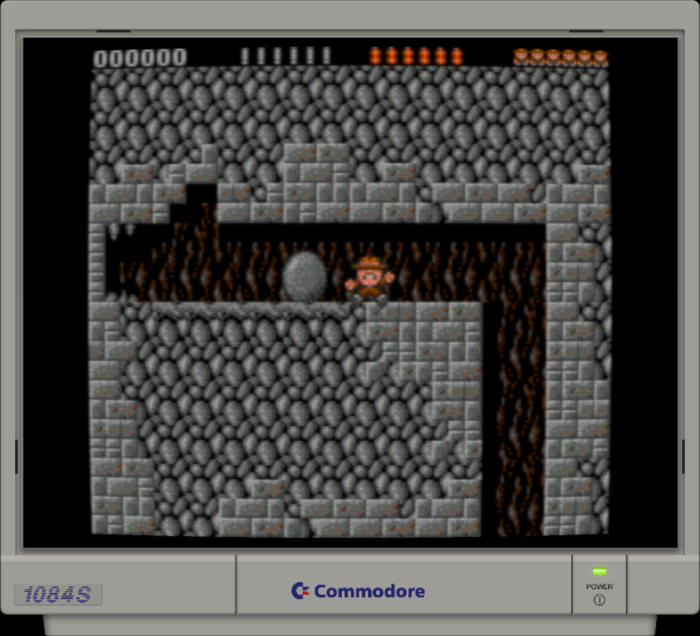
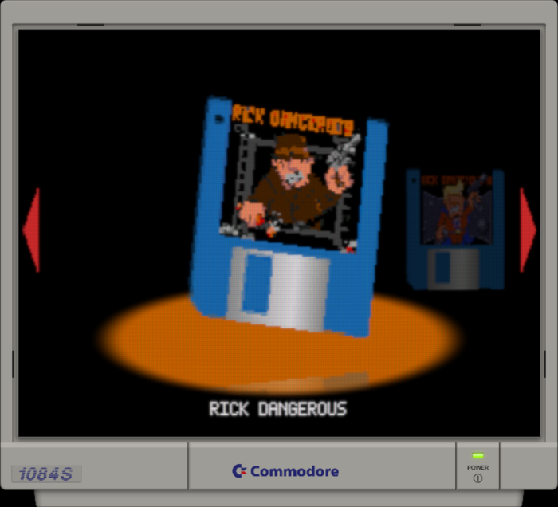
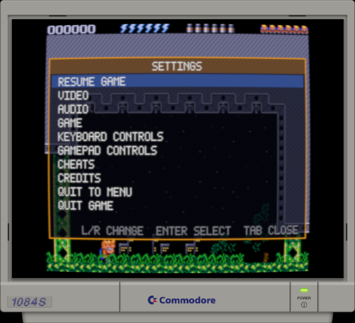

# Remember Rick Dangerous?

Way before Lara Croft, back in the 1980's and early 1990's, Rick Dangerous was the Indiana Jones of computer games, running away from rolling rocks, avoiding traps, from South America to a futuristic missile base via Egypt and the Schwarzendumpf castle.

**xrick** is an exact clone of both games in the series:

* Rick Dangerous, produced by carefully cracking and then reverse-engineering the original IBM PC (x86 CPU) and Atari ST (68k CPU) versions of the game, and then porting to C ;
* Rick Dangerous II, produced by having AI reverse-engineer the Atari ST (68k CPU) version of the game, and then porting to C, with manual control in the way.

Both games run on a real emulated Atari ST 68000 + YM2149, playing back the original sound-driver code directly for music and effects -- not a reimplementation.

**This repository contains the source code for xrick.**

<table>
<tr>
<td></td>
<td></td>
</tr>
</table>

## This Fork

This is [Senjin the Dragon](https://github.com/senjinthedragon)'s fork, built on top of [zpqrtbnk/xrick](https://github.com/zpqrtbnk/xrick)'s decompilation, RD2 port, real audio engine, AI solver / attract-mode demos, and web player. On top of that foundation, this fork adds:

* an SDL_GPU renderer with CRT shaders (EasyMode, Lottes, Royale), FSR1 upscaling, and CRT-monitor bezels ;
* a settings menu covering video, audio, controls and per-game cheats, with full gamepad remapping ;
* a diskette carousel for picking between the two games in place of a splash screen, with each game's own real title music, a floor reflection, and a death-scream sting on confirm ;
* modern, optional control schemes (dedicated shoot/bomb keys) alongside the original layouts ;
* full touch support on the web build - the diskette carousel, the settings menu, and gameplay itself (a 9-zone on-screen control scheme, multi-touch) are all playable on a phone with no keyboard or gamepad.

## See Also

* The project's home page at [rick-dangerous.org](https://www.rick-dangerous.org/) ;
* Play online at [senjinthedragon.github.io/xrick](https://senjinthedragon.github.io/xrick/) ;
* The complete Rick Dangerous code knowledge base in its [own repository](https://github.com/zpqrtbnk/xrick-kb) ;
* This fork, at [senjinthedragon/xrick](https://github.com/senjinthedragon/xrick).

## Credits

- **Rick Dangerous I & II**, the original games this whole project exists because of, by Core Design (published by Firebird) - thank you to Simon Phipps, Terry Lloyd, Ben Daglish, and David 'Ken' Pridmore
- **xrick** by [bigorno](https://github.com/zpqrtbnk/xrick) (Stéphane Gay) - the original reverse-engineered RD1, plus RD2, the real Atari audio engine, the AI solver / attract-mode demos, and the web player
- **This fork's SDL_GPU renderer, settings menu, gamepad remapping, modern controls, and game-select carousel** by [Senjin the Dragon](https://github.com/senjinthedragon)

This fork also builds on the work of others:

- **crt-royale** shader by [TroggleMonkey](https://github.com/libretro/slang-shaders/blob/master/crt/shaders/crt-royale/README.TXT) (GPL), via [libretro/slang-shaders](https://github.com/libretro/slang-shaders)
- **crt-easymode** shader by EasyMode (GPL), via libretro/slang-shaders
- **crt-lottes** shader by Timothy Lottes and the **sharp-bilinear** upscaler by Themaister (both public domain), via libretro/slang-shaders
- **FSR1** (FidelityFX Super Resolution 1.0) by AMD (MIT), via the RetroArch/libretro slang port (Unlicense)
- **Commodore 1084S** and **Atari SC1224** bezel images by [Duimon](https://github.com/Duimon/Duimon-Mega-Bezel) (CC BY-NC-ND 4.0), used unmodified
- **AtariAudio**, the Atari ST audio emulation this fork's RD2 port runs its real sound-driver code on, by Arnaud Carré (Leonard / Oxygene) (MIT)
- **Musashi**, the 68000 CPU emulator the same audio engine runs on, by Karl Stenerud (MIT)
- **The diskette art** on the game-select screen, by sheikh_tuhin via Openclipart (public domain / CC0)
- **stb_image.h** by [Sean Barrett](https://github.com/nothings/stb) (public domain)

## License

The code written for this fork is released under the **GNU General Public License, version 3 or (at your
option) any later version** - see [LICENSE](LICENSE). This matches the licences of the CRT shaders it includes
(crt-royale is GPL v2 or later, crt-easymode is GPL) and the "in the spirit of the GNU GPL" wording xrick's
author used.

A few things are covered by their own terms instead:

- **bigorno's original xrick code** keeps its original notice in each file.
- **Third-party code and shaders** keep the licences noted in the [Credits](#credits) above and in their file headers.
- **The bezel images** (Duimon) are CC BY-NC-ND 4.0 and are not covered by the GPL.
- **The diskette art** (sheikh_tuhin) is public domain / CC0 and is not covered by the GPL either, though
  nothing stops it being treated as such.
- **The original game's graphics and sound** belong to their respective owners (Core Design / Firebird) and are
  not covered by any licence here. As for who exactly holds those rights today, the situation is murky - the
  original author has discussed it with Simon Phipps in the past, and his Rick Dangerous page now has a
  paragraph about "who owns the rights to Rick now," and the answer is... it is hard to tell.
